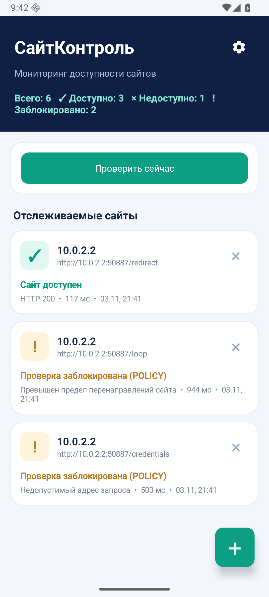

# Проверка версии 1.5

Дата: 03.11.2026. Это отчет о выполненных проверках с ограничениями их применимости.

## Что сделано

Обновлены инструменты сборки и уязвимые косвенные зависимости. Из комплекта Gradle исключен Commons Lang 2.x, встроенная Guava заменена исправленной версией. Происхождение архива и способ его повторного получения описаны в [TOOLCHAIN.md](TOOLCHAIN.md).

По результатам эмулятора исправлены две ошибки интерфейса: устаревший статус HTTP-сайта после запрета HTTP и перекрывающее кнопки всплывающее сообщение об ошибке ввода. Дополнительно проверяется отзыв разрешения HTTP перед следующим запросом в цепочке перенаправлений.

Подготовлен установочный APK без флага отладки, подписанный ключом выпуска. Закрытый ключ и пароли не опубликованы.

## Что проверено

| Проверка | Результат |
|---|---|
| Чистая сборка debug и release на macOS ARM64, Java 17.0.21+9 | Выполнена |
| Строгая проверка контрольных сумм зависимостей | Включена, сборка прошла |
| Автоматические тесты адресов, HTTP и перенаправлений | 16 из 16 прошли |
| Android Lint для двух вариантов | 0 ошибок; 24 предупреждений в локальной итоговой проверке |
| Повторное создание измененного архива Gradle | SHA-256 совпала с зафиксированной |
| Старт измененного Gradle официальным Wrapper | Проверен на новом кеше |
| Неверная сумма архива Gradle | Загрузка остановлена до запуска Gradle |
| Неверная сумма WorkManager в отдельной копии проекта | Сборка остановлена |
| База OSV: зависимости проекта и Gradle | 0 совпадений по 279 координатам |
| Перечень внешних JAR внутри Gradle | Все 125 сопоставлены с координатами; неопознанных нет |
| Подпись APK | Проверена, схемы v1, v2 и v3 |
| Манифест и правила копирования внутри APK | Копирование отключено, оба набора правил присутствуют |

Предупреждения Lint не отключены. Они касаются строк интерфейса, формы значков, отрисовки, синхронного сохранения и выбранных уровней Android. Проверяющая подпись программа также выдает предупреждения о служебных META-INF в контексте схемы v1; полный APK дополнительно защищен схемами v2/v3 на поддерживающих их версиях Android и имеет опубликованную SHA-256.

### Эмулятор

Использованы Android 16, API 36, ARM64 и подписанный APK с указанной ниже контрольной суммой. Девять групп проверок прошли:

1. Исходная версия 1.3 добавляет шесть синтетических адресов, различает успешный ответ и HTTP 502.
2. При установке 1.5 поверх 1.3 сохраняются шесть адресов и интервал в одну минуту. HTTP сразу заблокирован, запросы до согласия не отправляются.
3. Отмена согласия не включает HTTP. После разрешения HTTP появляются фактические результаты; цикл перенаправлений и учетные данные в перенаправлении блокируются.
4. Повторный адрес и URL с логином и паролем отклоняются. Текст ошибки читается в интерфейсе и дереве доступности.
5. После восстановления тестового сайта появляется уведомление. В нем есть только имя узла; пути и синтетического секретного параметра нет.
6. HTTPS-запрос к example.org выполняется со стандартной системной проверкой сертификата.
7. Фоновая задача WorkManager делает запрос, когда интерфейс приложения скрыт.
8. После остановки и повторного запуска процесса список сохранен. Удаление сайта работает.
9. В журнале AndroidRuntime нет падения процесса СайтКонтроля в ходе этого прогона.

Для проверки обновления версия 1.3 была собрана из предоставленных исходников новыми безопасными инструментами и подписана тем же тестовым ключом выпуска, что и 1.5. Это проверка совместимости данных при совпадающей подписи. Подпись уже установленной у пользователя версии 1.3 не исследовалась.

У фоновой задачи отдельно смоделировано прохождение 15-минутного периода: часы только виртуального устройства сдвинуты на 16 минут, затем задание запущено через системный планировщик в пространстве имен WorkManager. После прогона время и настройка автоматического времени восстановлены; разница с часами компьютера составила 0 секунд. Сам APK и код задачи для этого не менялись. Этот тест подтверждает исполнение задачи, но не точность реального расписания.

Сценарий tools/emulator_smoke.py принимает флаги --reset-test-app и --advance-emulator-clock. Без второго флага он ожидает реального периодического запуска. Скрипт отказывается работать с физическим устройством. В тестах использованы синтетические данные.



## Идентичность APK

Исходный коммит APK: `1f799c552bb2f885e0e6327ae1e1468a7d6fcfd6`.

SHA-256 установочного файла:

```text
bb408ff584f65352b2d1090abd013e2ea5bd1ce023c16b4fb3f92ab9a0f68174
```

SHA-256 сертификата подписи:

```text
d0ec938d2f94601baf545510183ff5769b68c57929cfd16023aa8b0277908537
```

Финальный тег также содержит отчеты и дополнительные суммы AAPT2 для Linux и Windows. Код приложения в нем совпадает с исходным коммитом APK. Контрольные суммы установочного файла и архива инструментов опубликованы в выпуске.

[Машиночитаемые результаты](https://github.com/MyTelexGlobal/SiteWatch-android/blob/v1.5.0/docs/verification.json) · [Перечень проверенных зависимостей](https://github.com/MyTelexGlobal/SiteWatch-android/blob/v1.5.0/docs/security-inventory.json).

## Что не проверено и ограничения

- Испытания на физических телефонах, на Android API 23 и на других версиях Android не выполнялись. Минимальный API 23 проверен сборкой и Lint, но не отдельным устройством.
- Не проверялись реальный 15-минутный период, длительное энергосбережение и ограничения производителей.
- Не выполнялось облачное копирование или восстановление с аккаунтом Google. Проверены настройки и ресурсы APK, исключающие данные из копирования. Ранее созданные резервные копии приложение не удаляет.
- Не проверялись совпадение подписи с пользовательским APK 1.3 и перенос ключа с другого компьютера.
- Контрольные суммы Linux и Windows AAPT2 сверены с Google Maven; сама сборка на этих системах не выполнялась.
- Автоматическая проверка GitHub не активирована: текущий доступ не включает разрешение workflow. В tools/github-actions.example.yml сохранен шаблон.
- Поиск по OSV ограничен известными каталогизированными проблемами. Нулевая выдача не доказывает отсутствие неизвестных уязвимостей и не является полным аудитом Java, Android SDK или операционной системы.
- HTTP после разрешения остается незашифрованным. Секреты в URL сохраняются в закрытом хранилище Android без дополнительного шифрования самим приложением.
