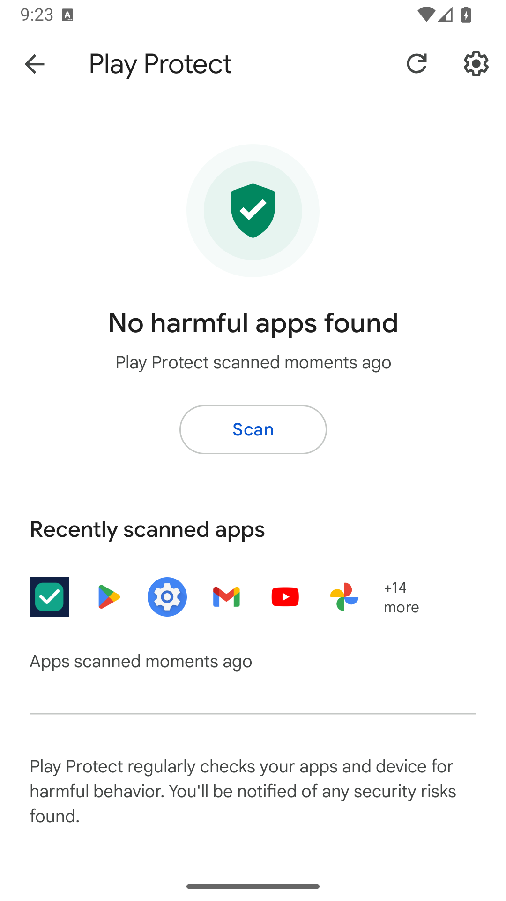

# Проверка версии 1.6.1

Дата: 03.11.2026. Приложение еще не опубликовано и не одобрено Google Play.

## Что сделано

Установлен целевой API 36, добавлены безопасные отступы системных панелей Android 15 и 16, прокрутка настроек и политика конфиденциальности без обращения к сети. При добавлении сайта объясняются запросы к выбранному серверу, передаваемые сведения и работа в фоне. User-Agent содержит название приложения вместо представления браузером Chrome.

Подготовлены APK для установки, AAB для Google Play, тексты карточки, изображения, реальные снимки экрана и перечень обработки данных. [Политика](https://mytelexglobal.github.io/SiteWatch-android/privacy.html) опубликована по HTTPS; скачанный текст побайтно совпал с файлом проекта. Закрытые ключи и пароли не опубликованы. Из объединенного манифеста исключены неиспользуемое разрешение FOREGROUND_SERVICE и служба WorkManager SystemForegroundService. Проверки остаются обычными периодическими заданиями. Ключ подписи APK сохранен от версии 1.5, для загрузки AAB подготовлен отдельный ключ.

## Что проверено

| Проверка | Результат |
|---|---|
| Чистая сборка APK и AAB на macOS ARM64, Java 17, Gradle 9.8.2 sitewatch.1 и AGP 9.5.0 | Прошла |
| Строгая проверка SHA-256 зависимостей | Включена, сборка прошла |
| Автоматические тесты URL, HTTP и перенаправлений | 16 из 16 прошли |
| Android Lint debug и release | 0 ошибок, по 24 предупреждения |
| Полный сценарий Android 16 API 36 ARM64 | 11 групп прошли |
| Формат AAB, официальный bundletool 1.18.3 | Проверен |
| APK, сформированный из AAB | Установлен поверх APK с тем же ключом на отдельном образе Google Play; запуск, HTTPS, настройки и политика работают |
| Штатное сканирование Play Protect после установки выпуска APK | «No harmful apps found»; СайтКонтроль указан среди проверенных |
| OSV: зависимости проекта и внешние библиотеки Gradle | 0 совпадений по 279 координатам; все 125 внешних JAR сопоставлены, неопознанных нет |
| Материалы магазина | Длины описаний проверены, значок 512 × 512, изображение 1024 × 500, три снимка 1080 × 1920 |

Подписи APK v1, v2 и v3 проверены apksigner. Подпись AAB проверена jarsigner. Предупреждение jarsigner о самоподписанном сертификате ожидаемо для ключа загрузки Android и само по себе не заменяет регистрацию этого ключа в Play Console. Предупреждения apksigner о META-INF относятся к схеме v1; полный APK также защищен схемами v2 и v3 на поддерживающих их версиях Android. Предупреждения Lint и устаревающих параметров AGP не скрывались.

### Проверки эмулятора

1. Сборка из исходников 1.3 добавляет шесть тестовых адресов и различает HTTP 200 и 502.
2. Обновление до 1.6.1 сохраняет адреса и интервал; HTTP немедленно заблокирован до согласия.
3. Проверены отмена и выдача согласия на HTTP, коды ответов, блокировка циклов и учетных данных в перенаправлении.
4. Повторные адреса и URL с логином и паролем отклоняются.
5. Уведомление о восстановлении не содержит путь и тестовый секрет.
6. HTTPS к example.org проходит со стандартной проверкой сертификата Android.
7. WorkManager выполняет запрос при скрытом интерфейсе.
8. Список сохраняется после перезапуска процесса, удаление сайта работает.
9. Кнопки главного экрана имеют отступы от краев системных панелей при API 36.
10. Политика конфиденциальности открывается из настроек.
11. Падения процесса приложения в AndroidRuntime за время прогона не найдены.

Для теста обновления версия 1.3 собрана из предоставленных исходников новыми инструментами и подписана тем же ключом, что и 1.6.1. Это не проверка подписи APK, установленного у пользователя ранее.

Период фонового задания смоделирован сдвигом часов только виртуального устройства на 16 минут и запуском задания через системный планировщик. После прогона восстановлены часы, автоматическое время и режим adb без root. Расхождение часов с компьютером при проверке составило около одной секунды. Тест подтверждает выполнение задания, но не реальное ожидание периода и не работу в Doze.

### Отдельная проверка Google Play Protect

Использован официальный образ Android 16 API 36 Google Play ARM64. На него установлен именно APK с указанной ниже суммой, затем вручную через штатный экран запущено сканирование. В дереве интерфейса зафиксированы состояния Scanning и No harmful apps found, время moments ago и СайтКонтроль в недавно проверенных приложениях. Аккаунт Google в виртуальное устройство не переносился, настройки защиты не отключались.

Этот результат ограничен одной проверкой одного файла на одном виртуальном устройстве. Он не является одобрением магазина, не подтверждает регистрацию разработчика и не доказывает снятие предупреждений на других телефонах.

### Проверка AAB

AAB проверен и преобразован в устанавливаемый APK через официальный bundletool, запущенный с уже закрепленными зависимостями AGP. Для этого служит tools/bundletool.gradle. Отдельный bundletool-all JAR не применяется в итоговой проверке: в нем встроены более старые библиотеки, которые не заменяются правилами проекта.

APK из AAB локально подписан ключом приложения и установлен на образ Google Play; проверены HTTPS, настройки и чтение политики. На нем получены реальные снимки 1080 × 1920 для магазина. Это проверка формирования и установки AAB, а не загрузка или предварительный отчет серверов Google Play.

## Файлы выпуска

Исходный коммит кода APK и AAB: 772238fe7a82866de5470c79de646e1d4a98d70e. Встроенные сведения о версии содержат этот коммит. Последующие изменения отчетов и инструментов проверки код приложения не меняют.

| Файл | SHA-256 |
|---|---|
| SiteWatch-v1.6.1.apk | 921a664797832a0971bda867994e546241e7004e3c65035cb4b1e6546ed803c6 |
| SiteWatch-v1.6.1.aab | 1f048b2ccbbd3a38a307249502233a9f7c87274c5239df90d3b2b413b53d0c23 |

Сертификат подписи APK: d0ec938d2f94601baf545510183ff5769b68c57929cfd16023aa8b0277908537.
Сертификат ключа загрузки AAB: d72497a79402fd9216b7d9f3a95a0bcbfc90faf30a44b9702cbfa45d2ff4ed02.
Публичные сертификаты приложены к материалам магазина. Это разные назначения ключей. При настройке Play App Signing нужно сохранить ключ подписи приложения, если требуется обновление уже установленного APK из GitHub.

[Результаты в JSON](verification.json) · [Перечень зависимостей](security-inventory.json) · [Проверка предыдущей версии 1.5](TESTING-v1.5.md).

## Что осталось неизвестным и ограничения

- Причина предупреждения на пользовательском телефоне не установлена: точный текст и результаты его Play Protect недоступны. Обход защиты не применялся.
- В новом личном аккаунте Google Play документы личности отправлены и проверяются Google. Следующий шаг подтверждения телефона зависит от одобрения личности. При последней проверке Console создание приложения было заблокировано. Пакет не зарегистрирован, AAB не загружен, отчета Google Play и решения о допуске нет.
- Для нового личного аккаунта еще предстоит обязательный закрытый тест и получение доступа к открытой публикации. Эмуляторы не заменяют реальных участников.
- Не выполнены окончательные анкеты Data safety и IARC, выбор стран и настройка Play App Signing.
- Физические телефоны, API 23, другие версии Android, реальные длительные периоды, Doze и ограничения производителей не проверены.
- Не выполнялось облачное восстановление; проверены политики APK. Удаление старых облачных копий не проверялось и не реализовано.
- Сборки на Windows и Linux и GitHub Actions не запускались.
- OSV охватывает известные каталогизированные проблемы в указанном перечне; это не полный аудит Java, Android SDK или ОС и не гарантия отсутствия неизвестных уязвимостей.
- HTTP по согласию остается незашифрованным, а полные адреса локально хранятся без дополнительного шифрования самим приложением.
